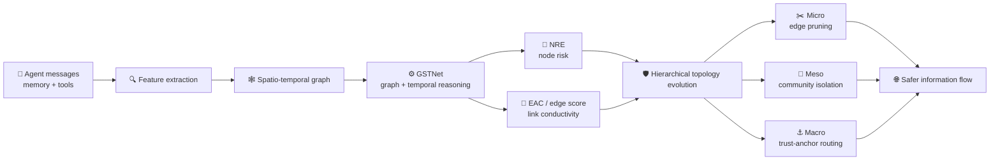

# 🛡️ TopoSHIELD

### *Reshaping the Flow of Malice via Spatio-Temporal Risk-Aware Topological Evolution in Multi-Agent Systems*

<p align="center">
  <a href="https://aclanthology.org/2026.findings-acl.426/"></a>
  <a href="https://github.com/NoWall-572/TopoSHIELD"></a>
  <a href="https://github.com/NoWall-572/TopoSHIELD/blob/main/LICENSE"></a>
</p>

<p align="center">
  
  
  
  
</p>

<p align="center">
  <b>TopoSHIELD turns the communication topology of an LLM-based multi-agent system into an active security surface.</b><br/>
  It senses evolving interaction risk, scores nodes and links, and reshapes information flow before a local compromise becomes a system-wide failure.
</p>

<p align="center">
  <a href="https://aclanthology.org/2026.findings-acl.426/">📄 Paper</a> ·
  <a href="https://aclanthology.org/2026.findings-acl.426.pdf">📥 PDF</a> ·
  <a href="#-quick-start">⚡ Quick start</a> ·
  <a href="#-citation">📝 Citation</a>
</p>

---

## 🏆 ACL 2026 Findings

> **TopoSHIELD has been accepted to Findings of the Association for Computational Linguistics: ACL 2026.**
> The paper appears in the ACL Anthology, pages **8740–8768**.

The core idea is simple and powerful: **when collaboration links can carry malicious influence, security must reason about the graph that carries the information.** TopoSHIELD combines spatio-temporal graph modeling with risk-aware topology evolution to suppress malicious diffusion while preserving the utility of multi-agent collaboration.

<div align="center">

| 🎯 Reported result | 📌 Value |
|:---:|:---:|
| Toxicity reduction on GPT-4o | **58%** |
| Task success rate | **>90%** |
| Evaluation instances in the released benchmark | **108** |
| Main attack families | **Prompt / Tool / RAG** |

</div>

> The numbers above are reported in the ACL 2026 paper. Reproduce the evaluation from the repository with the commands below.

---

## ✨ Why Topology Matters

LLM agents do not operate in isolation. They exchange observations, plans, tool outputs, and retrieved knowledge through a communication graph. A malicious instruction can therefore travel along the same edges that make the system capable.

TopoSHIELD treats that graph as a **dynamic defense variable**:

```text
🧠 Agent state + interaction logs
                │
                ▼
      🕸️ Spatio-temporal graph
                │
                ▼
   📈 Node risk + edge propagation scores
                │
                ▼
  🛡️ Topology evolution at three granularities
     ├── Micro  → prune weak / risky links
     ├── Meso   → isolate high-risk communities
     └── Macro  → route through a trustworthy anchor
```

### 🧩 The method in one glance



---

## 🧠 Core Architecture

TopoSHIELD builds a directed, attributed **spatio-temporal graph** from the execution trace:

- **Nodes** represent agents and their evolving internal / behavioral state.
- **Spatial edges** represent message passing at the current round.
- **Temporal edges** connect an agent's state across consecutive rounds.
- **Node features** summarize behavioral signals such as rejection patterns and semantic contradictions.
- **Edge features** summarize interaction context and historical attack signals.

The implementation is organized around a GSTNet backbone:

$$
H_i^t = \operatorname{GRU}(h_i^t, H_i^{t-1})
$$

$$
\hat{y}_{i,\mathrm{NRE}}^t = \sigma\!\left(\operatorname{MLP}_{\mathrm{node}}(H_i^t)\right)
$$

$$
\hat{y}_{ij,\mathrm{EAC}}^t = \sigma\!\left(\operatorname{MLP}_{\mathrm{edge}}\left([H_i^t \Vert H_j^t \Vert z_{ij}^t]\right)\right)
$$

Here, **NRE** is the node-level risk estimate and **EAC** is the edge-level propagation / affinity signal used to guide topology updates. The released implementation exposes the edge output as `eac_affinity` and prunes links below the configured affinity threshold.

The equations above follow the paper notation. In the released `GSTNet` implementation, the temporal path is realized with a learned decay recurrence and a 1-D temporal convolution, while the node-risk / edge-score dual-head interface remains the same.

### 🛡️ Three-level defense loop

| Level | Mechanism in code | Security role |
|:---:|:---|:---|
| 🟣 **Micro** | Edge pruning | Remove links whose learned affinity falls below `min_affinity_to_keep`. |
| 🟠 **Meso** | Louvain community isolation | Detect high-risk communities and block cross-community routes. |
| 🔵 **Macro** | Dynamic trust anchor | Route risky or disconnected agents toward the lowest-risk anchor. |

---

## 📊 Paper Highlights

The paper evaluates TopoSHIELD on multi-agent misinformation scenarios with three major attack surfaces:

| Attack family | What is stressed | CLI value |
|:---|:---|:---:|
| 🧪 Prompt injection | Agent state / instruction integrity | `inject` |
| 🛠️ Tool injection | Tool-mediated observations and actions | `tool` |
| 📚 RAG poisoning | Retrieved knowledge and context flow | `rag` |

The released dataset contains **108 reasoning tasks** across domains such as argument analysis, governance, science, and safety-critical decision making. Evaluation tracks both:

- **MT — Misinformation Toxicity:** how strongly the final system response follows the injected false premise.
- **TSR — Task Success Rate:** whether the original task remains successfully completed.

The design goal is a useful security trade-off: **block malicious flow while keeping the collaboration graph productive.**

---

## 📦 Repository Map

```text
TopoSHIELD/
├── sandbox/
│   ├── simulator.py          # Multi-agent simulation loop
│   ├── toposhield.py         # TopoSHIELD controller and topology updates
│   ├── st_gat_model.py       # GSTLayer / GSTNet implementation
│   ├── feature_extractor.py  # Node and edge risk features
│   ├── edge_finder.py        # Initial topology construction helpers
│   ├── agent.py              # Agent roles and execution logic
│   ├── llm.py                # Supported model configurations
│   └── ...
├── config/
│   ├── api_keys.yaml         # Provider keys and base URLs
│   └── defense.yaml          # Defense configuration
├── dataset/
│   └── MisinfoTask.json      # 108 evaluation instances
├── Vector_DB/                # Precomputed FAISS stores for RAG experiments
├── run.py                    # Main experiment entry point
├── final_comparison.py       # Aggregate JSONL outputs into comparison tables
├── prepare.py                # Download NLTK resources
├── test.sh                   # Example experiment command
├── requirements.txt
└── LICENSE
```

---

## ⚡ Quick Start

### 1. Clone and create an environment

```bash
git clone https://github.com/NoWall-572/TopoSHIELD.git
cd TopoSHIELD

conda create -n toposhield python=3.9 -y
conda activate toposhield
pip install -r requirements.txt
```

The code uses CUDA automatically when PyTorch detects a GPU; CPU execution is also supported.

### 2. Configure an LLM provider

Fill in the provider credentials in `config/api_keys.yaml`:

```yaml
openai_api_key: "YOUR_API_KEY"
openai_base_url: "YOUR_BASE_URL"
```

Then add or edit model entries in `sandbox/llm.py`:

```python
MODEL_LIST = {
    "gpt-4o": {
        "name": "gpt-4o",
        "nickname": "gpt-4o",
        "api_key": "",
        "base_url": "",
    },
    # Add another compatible chat model here.
}
```

For a fresh environment, download the NLTK resources used by preprocessing:

```bash
python prepare.py
```

### 3. Run one evaluation

```bash
python run.py \
    --instance_id 1 \
    --attack_method inject \
    --model gpt-4o-mini \
    --topo auto \
    --time_step 3 \
    --defense \
    --defense_method toposhield
```

A convenient alternative is the included example:

```bash
bash test.sh
```

### 4. Compare saved results

After runs finish, aggregate the JSONL files in `outputs/`:

```bash
python final_comparison.py
```

---

## 🎛️ Command-Line Controls

| Argument | Values / example | Meaning |
|:---|:---|:---|
| `--instance_id` | `1` | Run one dataset instance. The released dataset uses IDs `0–107`. |
| `--start_index` | `0` | Start index for batch evaluation. |
| `--end_index` | `108` | Exclusive end index for batch evaluation. |
| `--attack_method` | `vanilla`, `inject`, `tool`, `rag` | Select the attack surface. |
| `--model` | `gpt-4o`, `gpt-4o-mini`, `gemini-2.0-flash`, `deepseek-v3` | Choose the backbone listed in `sandbox/llm.py`. |
| `--topo` | `auto`, `chain`, `full` | Choose the initial MAS topology. |
| `--time_step` | `3` | Number of interaction rounds. |
| `--defense` | flag | Enable the defense controller. |
| `--defense_method` | `toposhield`, `none` | Select the defense strategy. |
| `--print_prompt` | flag | Print agent prompts during execution. |
| `--print_log` | flag | Print execution logs during execution. |

> To run dataset instance `0` alone, use `--start_index 0 --end_index 1 --instance_id 0`.

---

## 🔧 Implementation Snapshot

The main controller in `sandbox/toposhield.py` exposes a compact set of tunable defaults:

| Setting | Default | Purpose |
|:---|---:|:---|
| Node feature dimension | `6` | Per-agent behavioral / state features. |
| Edge feature dimension | `3` | Pairwise interaction features. |
| Hidden dimension | `64` | GSTNet representation size. |
| GST layers | `2` | Graph message-passing depth. |
| History window | `5` | Recent rounds retained by the feature extractor. |
| `min_affinity_to_keep` | `0.35` | Link retention threshold. |
| `isolation_threshold` | `0.85` | Node-risk threshold for isolation. |
| `community_risk_threshold` | `0.75` | Mean community-risk threshold. |

The controller executes the same closed loop on every defense round:

```python
X, Z = shield._build_gst_from_log(agent_list, current_step_log)
nre_scores, eac_affinity = shield.model(X, Z)
new_topology = shield._apply_multilevel_defense(
    nre_scores=nre_scores,
    eac_affinity=eac_affinity,
)
```

The resulting topology is written back into each agent's neighborhood and recorded in the run log.

---

## 📁 Outputs

| Path | Contents |
|:---|:---|
| `log/` | Full MAS operation and conversation traces. |
| `outputs/` | Per-instance JSONL metrics, including MT and task success scores. |
| `eval_goal/` | Goal-analysis traces produced by the auxiliary defense agent when enabled. |

The comparison script reads JSONL files from `outputs/` and prints Markdown tables grouped by attack family and defense method.

---

## 🌟 Reproducibility Notes

- Run the same `--model`, `--attack_method`, `--topo`, and `--time_step` settings when comparing defenses.
- Keep the dataset instance range fixed for a fair aggregate comparison.
- The released configuration supports `gpt-4o`, `gpt-4o-mini`, `gemini-2.0-flash`, and `deepseek-v3`; compatible provider endpoints can be registered in `sandbox/llm.py`.
- The generated logs and JSONL metrics are the primary artifacts for auditing a run and reproducing the paper tables.

---

## 📝 Citation

If TopoSHIELD is useful for your research, please cite:

```bibtex
@inproceedings{huang-etal-2026-toposhield,
  title     = {TopoSHIELD: Reshaping the Flow of Malice via Spatio-Temporal Risk-Aware Topological Evolution in Multi-Agent Systems},
  author    = {Huang, Ruiyang and Wang, Chenxi and Zhang, Tinghe and Liu, Fengrui and Sun, Jiayan and Wang, Haocheng and Wu, Yifan},
  booktitle = {Findings of the Association for Computational Linguistics: ACL 2026},
  pages     = {8740--8768},
  year      = {2026},
  publisher = {Association for Computational Linguistics},
  url       = {https://aclanthology.org/2026.findings-acl.426/},
  doi       = {10.18653/v1/2026.findings-acl.426}
}
```

📌 **Paper page:** <https://aclanthology.org/2026.findings-acl.426/>

---

## 🤝 Contributing

Ideas, bug reports, experiment extensions, and topology visualizations are welcome. Open an issue or submit a pull request with a clear experiment description and the command used to reproduce it.

---

<div align="center">

### 🌐 Make collaboration safer by making information flow observable.

⭐ If this project helps your work, consider starring the repository and sharing the paper.

</div>
